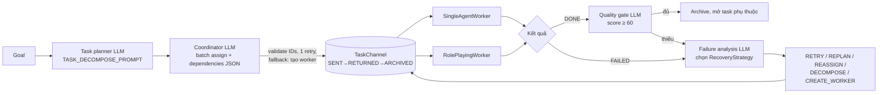
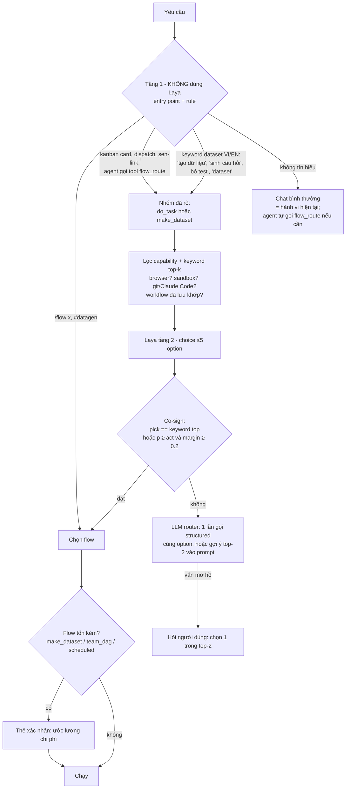

# Nghiên cứu: CAMEL-AI → cập nhật luồng SenClaw (task automation, data generation, router JEV sys-one, memory/graph)

Ngày: 2026-10-12 · Loại: research (chưa triển khai) · Phạm vi: `senclaw` daemon + `sen-sysone`

Nguồn chính: clone `camel-ai/camel` main @ `e5e5525` (2026-10-12, `__version__ = 0.2.91a7`), đọc tĩnh, không chạy code.
SenClaw @ `543b677` (senclaw), `sen-sysone` main. 5 agent đọc song song (CAMEL flows, CAMEL datagen/automation,
SenClaw flows, JEV sys-one, memory/graph); các điểm quan trọng đã tự kiểm lại trong code, đánh dấu **(đã kiểm)**.
Phần còn lại là kết quả scout kèm `file:line`, nên kiểm lại trước khi sửa.

## Mục lục
0. Kết luận nhanh
1. Mục tiêu và phạm vi
2. Task automation: CAMEL Workforce vs SenClaw
3. Data generation
4. Router chọn luồng bằng JEV sys-one
5. Memory + graph memory
6. Lỗi và doc drift phát hiện được
7. Roadmap đề xuất
8. Câu hỏi chưa giải quyết

---

## 0. Kết luận nhanh

| Mảng | Kết luận | Hành động |
|---|---|---|
| **Task automation** | SenClaw mạnh ở vòng lặp 1 agent (turn cap, stall nudge, compaction), DAG dispatch có write-set/worktree, kanban lease, scheduler/background (CAMEL **không có** scheduler). Thiếu: planner tự tách việc, recovery menu (replan/reassign/decompose), quality gate LLM, gán việc theo năng lực, fallback model, "playbook" học từ lần chạy thành công | Port 5 pattern của Workforce, **sửa các lỗi của CAMEL** khi port (§2.4) |
| **Data generation** | SenClaw chưa có gì. CAMEL có ~10 pipeline nhưng nhiều lỗi chất lượng; lõi đáng lấy là *verifier enum + filter chain + vòng accept-until-N* | Module mới `src/datagen/` nhỏ, 5 pipeline, dùng sandbox sẵn có của SenClaw để "chạy code gán nhãn" |
| **Router JEV sys-one** | Khả thi nhưng Laya **yếu khi đứng một mình**: route skill 15/32 đúng, "chào bạn" → x-browse p=1.00, không phân biệt được yêu cầu cần tool hay không. Thiết kế: entry point/rule quyết *nhóm* (chat / việc / dataset) → lọc capability → Laya `choice` ≤5 option *trong nhóm*, co-sign → LLM fallback → hỏi user. Raise-only | `src/decision/flow_route.rs` theo mẫu `skill_route.rs`, chạy shadow trước. **Phải sửa bug chọn model của sen-sysone trước** (§4.4) |
| **Memory/graph** | Thiết kế SenClaw **hợp lý và đi trước CAMEL**: đã có temporal graph trên SQLite (`cog_nodes`/`cog_edges`, `valid_from/valid_to/archived_at`, `as_of`). CAMEL chỉ có wrapper Neo4j/Nebula + 1 lần gọi LLM tách triple | **Không** đưa Neo4j/Qdrant/graph store mới. Sửa doc drift, flush reflection buffer, eval fusion/threshold |

---

## 1. Mục tiêu và phạm vi

1. Nghiên cứu CAMEL để cập nhật các luồng agent/task của SenClaw.
2. Nghiên cứu **data generation** và **task automation** của CAMEL để đưa vào SenClaw.
3. Dùng **JEV sys-one** (Laya local / Jev online) để chọn luồng datagen / automation phù hợp cho từng yêu cầu.
4. Đánh giá **memory + graph memory** của CAMEL so với SenClaw: có hợp lý không, có cần cập nhật không.

Non-goal: không đưa engine/inference vào daemon (giữ quyết định runtime split); không port code Python (khác ngôn ngữ),
chỉ port *pattern*; không thêm server ngoài (Neo4j, Nebula, Qdrant).

---

## 2. Task automation: CAMEL Workforce vs SenClaw

### 2.1 CAMEL Workforce chạy thế nào



Điểm chính (`camel/societies/workforce/`):
- Dispatch gate: task chỉ được post khi mọi dependency xong (`workforce.py:4491-4590`). Mode AUTO yêu cầu dep DONE; PIPELINE post bất kể kết quả.
- `RecoveryStrategy` (`utils.py:211`) + `FailureHandlingConfig{max_retries=3, enabled_strategies, halt_on_max_retries}` (`utils.py:227`). LLM đề xuất strategy bị **clamp** về danh sách cho phép; chỉ 1 strategy bật → bỏ qua LLM (`workforce.py:4765-4870`).
- Quality gate riêng cho kết quả DONE: `quality_score < 60` → đi đường failure, retry budget 2 (`workforce.py:5432-5560`).
- Pause/resume dùng `asyncio.Event` chung cho mọi agent; snapshot mỗi 30 s; `modify_task_content`, `skip_gracefully` (`workforce.py:2040-2551`).
- Workflow memory: lưu tóm tắt lần chạy theo role thành markdown, LLM chọn để nạp lại (`workflow_memory_manager.py:38-56, 1178`).
- Agent pool: clone sẵn, reset khi trả, dọn idle sau 180 s (`single_agent_worker.py:54-200`).

### 2.2 Đối chiếu với SenClaw

| Năng lực | SenClaw hiện tại | Gap |
|---|---|---|
| Tách việc (decompose) | Admin LLM tự viết cả DAG JSON một lần (`mcp/dispatch_server.rs:1170-1218`); kanban `breakdown_card` 1 lần gọi, chèn thẳng không review (`kanban/llm.rs:166`) | **lớn** |
| Gán worker theo năng lực | Chỉ khớp tên chính xác `resolve_agent` (`dispatch_server.rs:222-280`) | **lớn** |
| Dependencies | DAG theo label, kiểm cycle, continue-on-error, output dep lỗi được gắn nhãn "unverified" (`dispatch_bridge/dag.rs`) | không |
| Song song | Mọi task startable đều chạy; cap theo persona 5, theo JID 1, **không có cap toàn cục** (`bridge.rs:1387-1416`) | nhỏ |
| Phục hồi lỗi | 1 lần retry hạ tầng tự động + retry tay không giới hạn (`bridge.rs:726-1000`); **không replan, không reassign** | **lớn** |
| Quality gate | Checklist tất định (`dispatch_bridge/verification.rs:6`); checklist tự sinh chỉ mang tính tham khảo; không có LLM judge | **lớn** |
| Thảo luận / critic | Discuss team chỉ có thiết kế (`docs/discuss-team-design.md`), daemon không có code | **lớn** |
| Chia sẻ memory giữa worker | Theo folder; virtual worker DAG dùng thư mục tạm bị xoá khi `Drop`, memory override `(None, None)` (`virtual_worker_pool.rs:293`, `bridge.rs:1568`) | lớn (nhưng xem §5: không nên copy-all như CAMEL) |
| Học từ lần chạy | Failure ledger chỉ ghi, không ai đọc (`failures/mod.rs:144`); trajectory tắt mặc định | **lớn** |
| Fallback model khi lỗi API | Không có. `query_llm` không backoff 429/5xx (`zen_core/query_llm.rs:267`); `loop_controller.rs` có `CircuitBreaker`/`ErrorTier` nhưng **không ai gọi** | **lớn** |
| Vòng lặp 1 agent | 30 turn, stall nudge 4/8, final-answer turn, compaction 80% (`zen_core/conversation.rs`) | không (tốt hơn CAMEL) |
| Human-in-the-loop | Permission bridge, ask/form, plan exit, pause/resume (`permission_bridge/bridge.rs:647`, `pool.rs:2351`) | nhỏ |
| Workflow tĩnh | Agent + script step, cascade-skip, `PartialFailed` (`workflow/executor.rs`) | nhỏ |
| Lịch / chạy nền | Cron/interval/once + watch + background có backoff, quarantine (`scheduler/`, `background/`). Mode `isolated`, `script-agent` là **stub** | CAMEL không có; SenClaw đi trước, nhưng cần lấp stub |
| A2A | sen-link → tạo card kanban, kết quả lấy bằng poll (`sen_link/server.rs:143`) | nhỏ |

### 2.3 Pattern nên port (đích trong SenClaw)

| # | Pattern | Đích | Effort |
|---|---|---|---|
| A | **Planner**: `create_parent_and_run` nhận chỉ `goal` → planner LLM sinh `tasks[]` đúng schema hiện tại. Validate: cycle (đã có), tên agent tồn tại, **cap ≤ 12 task, depth ≤ 2**. Tuỳ chọn đưa vào cột `triage` của kanban để người duyệt. Lấy 2 nguyên tắc prompt của CAMEL: subtask tự đủ ngữ cảnh, song song hoá tối đa | `mcp/dispatch_server.rs`, `agent/dispatch_bridge/` | M |
| B | **Gán theo năng lực**: mô tả persona + danh sách tool → 1 lần gọi structured gán cả lô, validate với ID đang sống, sửa 1 lần, fallback = khớp tên như hiện nay. Khi ≤ 5 persona ứng viên có thể cho Laya chọn (cùng cơ chế §4) | `resolve_agent`, `persona_registry.rs` | M |
| C | **Recovery menu**: sau khi hết retry hạ tầng → `RecoveryStrategy {Retry, Replan, Reassign, Decompose}` + `FailureHandlingConfig {max_retries: 3, enabled, halt_on_max}`. Chỉ gọi LLM phân tích khi > 1 strategy bật; clamp kết quả. Đưa episode của **failure ledger** vào prompt phân tích (lần đầu ledger có người đọc). Cap tổng task pending (CAMEL: 20). Lưu trong `DispatchState` | `dispatch_bridge/bridge.rs` (`mark_task_error`/`mark_task_timeout`) | M |
| D | **Quality gate**: sau `done` + checklist, tuỳ chọn `verify: judge` → điểm 0-100, ngưỡng 60, retry 2. **Fail-closed**: parse lỗi → `needs_review`, không coi là xong (CAMEL fail-open, mặc định 80 điểm) | `dispatch_bridge/verification.rs` | S-M |
| E | **Fallback model + backoff 429/5xx**: nối `ErrorTier::classify`/`CircuitBreaker` đã có vào `query_llm` | `zen_core/query_llm.rs`, `control_plane/loop_controller.rs` | M |
| F | **Playbook (workflow memory)**: khi parent xong và **mọi task đã verify**, tóm tắt thành curated memory loại `procedure` (người dùng duyệt); planner nạp top-k theo persona/goal. CAMEL lưu cả lần chạy thất bại, đừng chép | `memory/curated.rs`, planner prompt | M-L |
| G | **Pause / sửa / resume ở mức parent**: cờ pause chặn `process_next_pending`, cho sửa prompt task trước khi chạy lại (đã có `paused_admins`) | `dispatch_bridge/bridge.rs` | S |
| H | Lấp stub scheduler `isolated` (dùng `run_one_shot` sẵn có) và `script-agent` (đưa stdout vào agent), hoặc sửa CLAUDE.md | `scheduler/executor.rs:100-106, 185-212` | S |
| I | (P2) Review panel / discuss: N persona chấm một deliverable, có tổng hợp điểm, `max_rounds` | daemon mới hoặc app riêng | L |

### 2.4 Lỗi của CAMEL không được chép

- Quality parse lỗi → mặc định `quality_score=80`, coi như đạt (`workforce.py:1645`). SenClaw phải fail-closed.
- Không cap depth, không cap số worker (fallback tạo worker + CREATE_WORKER không giới hạn, chỉ dừng khi pending > 20).
- `workforce.py:4556-4560`: khối `failed_deps` đặt sai indent → có thể `UnboundLocalError`.
- Summarization bị bỏ qua khi context đã vượt limit (`chat_agent.py:1038`); `ScoreBasedContextCreator` không cắt gì cả, tên gây hiểu nhầm.
- `step_timeout` đồng bộ không chặn được thời gian thật (ThreadPoolExecutor chờ thread).
- Workflow memory lưu cả lần chạy không thành công.
- Coordinator chỉ đọc mô tả text của worker: không biết tải, năng lực, lịch sử.

---

## 3. Data generation

### 3.1 Các pipeline của CAMEL

| Pipeline | Vào → Ra | Kiểm chất lượng | Chi phí / mẫu | Ghi chú |
|---|---|---|---|---|
| Self-Instruct (`datagen/self_instruct/`) | seed instruction → instruction + I/O | Heuristic: độ dài, keyword, ROUGE-L ≤ 0.7 | ~3 lần gọi | Keyword filter so substring ("data" chặn cả "database"); `[0]` crash khi output rỗng |
| CoT golden search (`datagen/cot_datagen.py`) | Q + đáp án → lời giải từng bước | LLM judge, binary search lỗi theo câu | 2 → ~200 lần gọi | Docstring nói MCTS nhưng không có |
| Self-improving CoT (`datagen/self_improving_cot.py`) | bài toán → trace đã critique-refine | Judge 3 chiều ≥ 0.7, tối đa 3 vòng, so `\boxed{}` | 2-8 | Regex boxed sai với ngoặc lồng (đã chạy thử); ngưỡng int tắt luôn gate |
| Evol-Instruct (`datagen/evol_instruct/`) | prompt → bản khó/đa dạng hơn | LLM chấm 1-5, không ngưỡng | 2×N/vòng | Pool lồng 10×10 ≈ 100 call đồng thời |
| Source2Synth (`datagen/source2synth/`) | đoạn văn → QA nhiều bước | Độ dài, complexity ≥ 0.5, dedupe hash | 2-5 / đoạn | Không có LLM thì ra rỗng |
| Execute-to-label (`datasets/few_shot_generator.py`) | seed Q/A → Q mới + code; **nhãn = stdout** | Chạy được là đạt | 1 call + 1 lần chạy | Tín hiệu mạnh nhất cho dữ liệu tính được; CAMEL chạy trong host venv (không phải sandbox) |
| Persona Hub (`personas/`) | text → persona liên quan | Dedupe cosine ≥ 0.85 | 1-2 | Là bộ điều kiện đa dạng, không phải nguồn đáp án |
| Data collectors (`data_collectors/`) | lịch sử agent → Alpaca / ShareGPT (giữ tool call) | — | 0 (convert) | Alpaca dính chữ không có dấu cách |
| Verifiers (`verifiers/`) | `Verdict {SUCCESS, FAILURE, ERROR, TIMEOUT}`, retry chỉ khi lỗi/timeout | Math (symbolic), Python (subprocess), Physics (sympy) | — | Lõi đáng port nhất |
| RL env (`environments/`) | episode + reward | verifier/game engine | 1 / step | Không hợp với daemon cá nhân |

### 3.2 Đưa gì vào SenClaw và để làm gì

SenClaw có sẵn 3 thứ CAMEL thiếu: **sandbox thật** (Seatbelt/bubblewrap/Docker, `src/sandbox/`, `docs/sandbox-guide.md`)
**(đã kiểm)**, **trajectory JSONL** của chính agent, và **wiki/memory** làm nguồn tài liệu. Vì vậy chọn:

| Flow SenClaw | Ghép từ CAMEL | Dùng cho |
|---|---|---|
| `expand_seeds` | Self-Instruct + Evol-Instruct (gộp: sinh mới hoặc làm khó hơn) + persona làm cờ đa dạng | Sinh **bộ eval cho router §4** (biến thể câu yêu cầu Việt/Anh cho từng flow), bộ test skill |
| `doc_qa` | Source2Synth | Câu hỏi nhiều bước từ wiki/tài liệu (study app, ôn tập, eval RAG của memory §5) |
| `reasoning_traces` | CoT golden + self-improving (sửa ngưỡng, dùng extractor boxed đúng) | Lời giải từng bước có kiểm tra |
| `executable_qa` | Execute-to-label, **chạy trong sandbox SenClaw**, fail-closed khi sandbox `Degraded` | Bài toán tính được, data/logic QA |
| `export_logs` | Data collectors | Trajectory → ShareGPT/Alpaca; dữ liệu fine-tune Laya (vd. `laya-browser` từ trajectory của browser engine) |

Bỏ: RL env, prompt-template generators, Source2Synth heuristic-only, denylist terminal làm ranh giới bảo mật.

### 3.3 Thiết kế đề xuất `src/datagen/`

```text
datagen/
  verdict.rs    Verdict {Success, Failure, Error, Timeout}; trait Verifier; retry chỉ khi Error/Timeout
  filters.rs    FilterChain có tên lý do loại: độ dài, keyword (whole-word), ROUGE-L dedupe, hash dedupe
  generator.rs  vòng accept-until-N: budget retry dùng chung, parse serde từng item, cap đồng thời, cap token/$
  pipelines/    expand_seeds, doc_qa, reasoning_traces, executable_qa, export_logs
  runner.rs     chạy như job nền: event tiến độ qua WS, huỷ được, ghi
                $SENCLAW_DATA_HOME/datasets/<name>/{data.jsonl, manifest.json}
```

- `manifest.json`: seed, model, filter, số chấp nhận / loại theo lý do, chi phí. Đây là thứ CAMEL thiếu để tái lập.
- Gọi LLM qua provider sẵn có và ghi `usage` như mọi lần gọi khác. Daemon vẫn không chứa inference.
- MCP tools trong core server: `datagen_start`, `datagen_status`, `datagen_cancel`, `datagen_list`.
- Mọi job datagen phải có **thẻ xác nhận** (ước lượng số lần gọi/chi phí) trước khi chạy, đúng nguyên tắc raise-only ở §4.

---

## 4. Router chọn luồng bằng JEV sys-one

### 4.1 Hiện trạng decision runtime

- Contract: `POST /api/decision/ask` ≡ `POST /v1/systemone` (cùng handler, `sen-sysone/src/http.rs:319-325`). Trả **xác suất**: `choice` → `probabilities` có thứ tự, `answer_confidence` = max p.
- Có 4 nơi gọi:
  - router skill trước khi chạy (`agent_pool/pool.rs:1641-1686`)
  - tool gate cho shell (`decision/gate/mod.rs:112-185`)
  - input guard ở chế độ shadow (`pool.rs:1706-1735`)
  - bước browser (`browser_agent/run.rs:976-1006`)
- Ladder (`control_plane/ladder.rs`): rule → Laya → LLM → human. Band: ≥ act → làm; ≥ fallback → fallback; còn lại review.
- Giới hạn:
  - Mỗi option tối đa 48 token. Tổng option phải vừa `head_max_len`: multilingual = 256 trên máy này; vượt thì báo 422.
  - Context `max_len` 1024; state dài bị cắt im lặng.
  - Warm ~75 ms, cold 3-4 s, mỗi model nạp tốn 1.2-1.7 GB RAM.
- Tiếng Việt **bắt buộc** dùng checkpoint `multilingual`; checkpoint English đọc tiếng Việt sai mà vẫn tự tin.
- Đo được:
  - Skill route: Laya một mình 15/32; keyword 20-23/32; co-sign 14 đúng / 2 sai.
  - Gate 8 lựa chọn: 12/16 với multilingual.
  - Câu hỏi yes/no (`noul`) gần như ngẫu nhiên (memory 2026-09-29).

- Tool discovery (`plans/reports/research-260926-1254-jev-tool-discovery.md`, ghi trong CLAUDE.md): trên 78 prompt cần tool và 36 không cần, Laya **không phân biệt được** yêu cầu nào cần tool. Chỉ 3/32 lần nó chọn "none".

Hệ quả thiết kế:
- Laya **không được tự quyết một mình**. Chỉ dùng nó cho câu hỏi `choice` ít option, tương phản rõ, luôn có co-sign hoặc fallback.
- Câu "đây là chat hay là việc cần chạy luồng?" **không giao cho Laya**. Câu đó do entry point và rule quyết; Laya chỉ chọn *trong* một nhóm luồng đã xác định.

### 4.2 Luồng quyết định



Nguyên tắc:
- **Raise-only**. Router chỉ chọn luồng hoặc *thêm* bước xác nhận. Nó không bao giờ duyệt tool hay bỏ qua một lần pause. Khi không chắc thì quay về chat thường, tức hành vi hiện tại.
- Gửi `model: "multilingual"` **tường minh** (xem bug §4.4).
- Option ngắn (~15-25 token), tương phản theo **loại đầu ra**, không theo chủ đề.
- Tầng 1 (nhóm) chỉ do entry point/rule quyết. Thêm một tool `flow_route` cho chat agent: LLM của chat tự quyết khi nào cần luồng (việc nó làm tốt hơn Laya), còn router chọn luồng cụ thể.

Bộ option tầng 2 đề xuất (chưa probe; phải đo bằng bộ eval sinh từ `expand_seeds`):

| Nhóm | Option | Mô tả gửi cho Laya | Map sang SenClaw |
|---|---|---|---|
| 2a | `single_agent` | one agent with tools, a short loop | chat + tools (mặc định) |
| 2a | `team_dag` | split into parts for several specialists, run in parallel, then merge | DAG dispatch + planner (§2.3 A) |
| 2a | `saved_workflow` | run a saved fixed-step workflow that matches | workflow engine (ứng viên động từ registry) |
| 2a | `browser` | open, read or fill web pages | browser engine v2 |
| 2a | `code_change` | change a code repository and pass its tests | Claude Code cowork + worktree |
| 2a | `scheduled` | repeat or run later at a set time | scheduler/background |
| 2b | `expand_seeds` | turn sample prompts into many new, harder or varied ones | §3.2 |
| 2b | `doc_qa` | write multi-step questions and answers from documents | §3.2 |
| 2b | `reasoning_traces` | write step-by-step solutions checked against answers | §3.2 |
| 2b | `executable_qa` | write computable problems; answers come from running code | §3.2 (cần sandbox) |
| 2b | `export_logs` | convert past agent sessions into a dataset | §3.2 |

Tầng 2a có 6 option, nhiều hơn mức 5 an toàn. Lọc capability cộng keyword top-k sẽ cắt xuống ≤ 5 trước khi hỏi Laya.

### 4.3 Hiện thực

- `senclaw/src/decision/flow_route.rs` theo mẫu `skill_route.rs`:
  - hàm `decide()` thuần, test được không cần engine
  - hàm `route()` async trả report, `ROUTE_TIMEOUT` 1.5 s
  - gọi qua `client::ask`
- Điểm gọi:
  - entry point đã biết nhóm: tạo parent dispatch, card kanban được claim, tool `datagen_start` không có `pipeline`
  - tool mới `flow_route` cho chat agent
  - khi keyword tầng 1 khớp, gắn cạnh `route_skill` (`pool.rs:1769`), sau khi đã kiểm directive `#` và `/`
  - **Không** chạy trên mọi turn chat. Như vậy cũng tránh nạp Laya 1.2-1.7 GB cho mọi tin nhắn.
- Settings: `decisionConfig.flows.mode` = `off | shadow | hint | on` (copy `SkillRouteSettings`, `decision/settings.rs:69-75`). Rollout theo thứ tự: shadow (chỉ log) → hint (chèn top-2 vào prompt) → on.
- Log vào bảng `flow_route_log` (copy `skill_route_log`, `db/schema.rs:325`). Ghi: prompt ≤ 300 ký tự, option, **cả vector xác suất**, band, model, latency, fallback. Thêm cột `human` khi người dùng xác nhận hoặc đổi lựa chọn (theo `tool_gate_log.human`).
- Đăng ký spec `flow.route` vào `control_plane/registry.rs` để có trace, JEV_OFF và G1 replay.
- Eval:
  - Case trong `evals/cases/*.json` có `decision_assertions`.
  - Đo precision ở band act cho từng flow.
  - So McNemar với baseline không có router.
  - Ngưỡng khởi điểm: act 0.6 / fallback 0.2 (giống browser local), cộng điều kiện margin top1 − top2.

### 4.4 Việc phải làm trước

1. **Bug chọn model của sen-sysone (đã kiểm)**: `plan_local` (`sen-sysone/src/decision/laya/runtime.rs:455-478`).
   - Model đã nạp được sort theo id. `laya-browser` có kind `Multilingual` (`store.rs:138`).
   - Khi chưa đặt default model mà cả `laya-browser` và `multilingual` cùng nạp, `laya-browser` đứng trước vì "l" < "m". Nó sẽ trả lời **router skill và tool gate** cho cả text tiếng Việt lẫn ASCII, dù catalog ghi "Không dùng cho việc khác".
   - Sửa: đánh dấu checkpoint chuyên dụng (vd. `purpose: Browser`), loại nó khỏi auto-pick, thêm test cho `plan_local`. Các caller trong daemon cũng nên gửi `model` tường minh.
2. **`laya-browser` cài trên máy này là bản cũ (đã kiểm)**.
   - Thực tế: `source.json` ghi `subfolder: v10s`, `laya_fmt: v3`, import từ folder `/Users/benji/Projects/Laya-jev/models/laya-browser` ngày 2026-09-25.
   - Catalog thì trỏ release `model-laya-browser-v19s`, và export script yêu cầu `laya_fmt == "v5"` (`tools/laya-browser-export/export.py:231`).
   - Số đo browser trên máy này vì vậy đến từ checkpoint cũ. Cần cài lại từ catalog.
3. Ba spec đã khai báo nhưng chưa có ai gọi: `clarify.needed`, `task.done`, `loop.next_step`. Chúng chưa dùng được làm nền.

---

## 5. Memory + graph memory

### 5.1 So sánh

| Trục | CAMEL | SenClaw | Đánh giá |
|---|---|---|---|
| Ngắn hạn | Lịch sử không giới hạn; summarize ở 50%, nén toàn phần khi summary > 60%; "score-based" thực ra không cắt (`chat_agent.py:1032-1234`, `score_based.py:112`) | Compact ở 80%, giữ 12 tin gần nhất, có fallback; tóm tắt được chưng cất vào curated memory (`zen_core/conversation.rs:39-52`) | SenClaw tốt hơn |
| Truy hồi ngữ nghĩa | Vector từng message, mặc định Qdrant + OpenAI embedding, không chunk; hybrid dùng RRF (`retrievers/hybrid_retrival.py:237`) | Chunk 400/80, 4 provider embedding có cache, FTS5 BM25 + vector quét chính xác, trộn tuyến tính 0.7/0.3, query rewrite theo rule (`memory/fts_search.rs:274-336`) | Hợp lý ở quy mô local. Cần eval fusion/ngưỡng, không cần thiết kế lại |
| Ghi | Tự động mỗi message, không dedupe, không decay | `memory_save` có chặn trùng (cần `supersede`), chưng cất khi compaction, reflection → cognify, decay ra archive, bảo trì 24 h | SenClaw tốt hơn rõ |
| **Graph** | Graph ABC + Neo4j/Nebula (cần server). `KnowledgeGraphAgent` = 1 lần gọi LLM + regex, id là chuỗi thô, **không temporal, không entity resolution**, không có graph retriever trong repo | SQLite `cog_nodes`/`cog_edges` có `valid_from`/`valid_to` (thời gian thực tế) + `archived_at` (thời gian hệ thống). Predicate single/multi tự supersede. Hebbian/tier, truy vấn `as_of`, `cog_history`. Resolution: khớp tên lúc ingest + merge alias bằng vector khi bảo trì (`memory/cognitive/schema.rs:217-320`) | **SenClaw đi trước. Không lấy stack graph của CAMEL** |
| Đa agent | `share_memory` chép mọi record cho mọi worker, dedupe theo uuid | Phạm vi theo group (`NodeSet::group`); không chia sẻ chéo agent | Đủ cho daemon cá nhân. Chép tất cả gây phình prompt |
| Thủ tục / kinh nghiệm | Workflow memory theo role (không lọc theo thành công) | `patterns/` là thư viện prompt tĩnh; trajectory là kênh phụ; failure ledger chỉ ghi | Gap thật, xử lý bằng playbook (§2.3 F) |
| Vận hành | Neo4j, Nebula, Qdrant, Memanto (HTTP từ xa) | 1 file SQLite WAL, rusqlite bundled; **không mã hoá** memory DB và file curated | SenClaw hợp local-first |

**Trả lời câu hỏi "có cần graph memory mới không"**: không. Graph temporal nhẹ trên SQLite *chính là* `cog_nodes`/`cog_edges`
đang có. Gap còn lại nằm ở 3 chỗ:
- Chất lượng ingest: predicate tự do mặc định `multi` nên không bao giờ supersede; entity resolution lúc ingest chỉ khớp tên chính xác.
- Chính sách recall: `pre_cognitive` mặc định tắt, nên graph chỉ được dùng khi agent chủ động gọi.
- Buffer reflection chỉ nằm trong RAM.

### 5.2 Cập nhật đề xuất

| Mức | Việc | Đích | Effort | Rủi ro |
|---|---|---|---|---|
| P0 | Sửa doc drift (§6 mục 8-14) | `docs/memory.md`, `knowledge-cognitive-flow.md`, `curated-memory-design.md`, `code-knowledge-graph.md`, comment `decay_tick.rs:62`, `cognify.rs:10-11`, `embedding_providers.rs:3-4` | S | thấp |
| P1 | Flush reflection buffer khi tắt daemon. Hiện buffer là map static, restart là mất các turn chưa flush | `agent/agent_pool/reflection.rs:44-45` | S (flush) / M (persist + cursor) | trích trùng nếu persist mà không có cursor |
| P1 | Eval ngưỡng vector. Min-max chuẩn hoá theo từng query nên top hit luôn được 1.0; `min_score` 0.25 vì thế là *tương đối* | `fts_search.rs:565-586` | M (cần bộ query có nhãn; sinh bằng `doc_qa` §3) | mất recall |
| P1 | RRF thay trộn 0.7/0.3 (0.7/0.3 là quyết định đã ghi trong docs, **cần bạn đồng ý**) | `fts_search.rs:274-336`, `cognitive/retrievers.rs:485-531` | S | đổi thứ hạng |
| P1 | Tool tìm read-only trong `trajectory/*.jsonl` theo group, cho các turn đã bị compaction (ý từ `context_summarizer_toolkit.py:542` của CAMEL) | `trajectory/`, MCP memory | M | lộ dữ liệu chéo group nếu scope sai |
| P2 | Chuẩn hoá predicate lúc ingest | `cognify.rs:52-75` | S-M | supersede nhầm |
| P2 | Playbook `procedure` từ lần chạy thành công (= §2.3 F) | `memory/curated.rs` | M-L | công thức lỗi thời, phình prompt |
| P2 | Merge alias ngay lúc ingest, chỉ sau khi có benchmark | `cognify.rs:587-612` | M-L | merge nhầm |
| Quyết định | Code chết: `daily_logger.rs`, `search.rs` legacy; GNN reranker ~1300 dòng chỉ test dùng | `memory/`, `cognitive/gnn*.rs` | S | — |

**Không áp dụng**: Neo4j/Nebula, Qdrant làm mặc định, Memanto, graph store thứ hai, kiểu chia sẻ copy-all của Workforce.

---

## 6. Lỗi và doc drift phát hiện được

| # | Vấn đề | Chỗ | Nguồn |
|---|---|---|---|
| 1 | `laya-browser` có thể trả lời router/gate | `sen-sysone/src/decision/laya/runtime.rs:455-478` | **đã kiểm** |
| 2 | `laya-browser` đang cài là v10s/fmt v3, catalog là v19s/fmt v5 | `~/.senclaw/local-models/laya/laya-browser/source.json` | **đã kiểm** |
| 3 | Mode scheduler `isolated`, `script-agent` là stub, trong khi CLAUDE.md mô tả như đã chạy | `scheduler/executor.rs:100-106, 185-212` | scout |
| 4 | `SCHEDULER_INTERVAL_SEC` không ai đọc; cadence hardcode 30 s | `config.rs:592`, `lib.rs:2304` | scout |
| 5 | Không backoff 429/5xx, không fallback model; `loop_controller` hứa nhưng không được nối | `zen_core/query_llm.rs`, `control_plane/loop_controller.rs:36` | scout |
| 6 | Permission waiter khoá theo **tên tool**: 2 prompt đồng thời cùng tool thì cái đầu bị từ chối im lặng (xác suất thấp vì tool có prompt chạy tuần tự) | `zen_core/events.rs:139-150` | scout, chưa test |
| 7 | Ghi `memory_chunks_vec` bằng `let _ =`, nuốt lỗi bảng không tồn tại | `memory/manager.rs:427` | scout |
| 8 | `docs/memory.md` mô tả `DailyLogger::append` mỗi message và `search.rs` như đang chạy; cả hai không có caller | `pool.rs:1871-1874` | scout |
| 9 | `docs/memory.md` + `embedding_providers.rs:3-4` mô tả provider candle/BERT `--features local-embed`; thực tế gọi runtime llama.cpp | `embedding_providers.rs:446` | scout |
| 10 | Docs nói decay đặt `valid_to`; code chỉ đặt `archived_at` | `cognitive/triplet.rs:265-266`, `decay_tick.rs:62` | scout |
| 11 | `cognify.rs:10-11` ghi "exact → fuzzy → vector"; ingest chỉ khớp exact | `cognify.rs:598-600` | scout |
| 12 | `curated-memory-design.md` mô tả inject lúc bắt đầu session; code inject mỗi message | `pool.rs:1844-1862` | scout |
| 13 | `code-knowledge-graph.md` mô tả `src/code_graph/*`, nhưng tree này không có (có thể ở nhánh khác) | — | scout |
| 14 | `cowork-flow.md`, `DISPATCH_COWORK_FLOW_ANALYSIS.md` §2-9, §13 mô tả `CoworkManager`, `src/cowork/mod.rs`, đều không còn; runtime hiện tại tự ghi chú "no agent dispatch yet" | `gateway/ui_server/cowork_runtime.rs` | scout |
| 15 | Comment `tools/dispatch.rs:506` ghi "Stops on first error"; code chờ tất cả | `dispatch_server.rs:855-890` | scout |
| 16 | Tool gate có thể **tự duyệt** (P(read+test+edit) ≥ 0.9), lệch với quy tắc raise-only đã ghi cho browser risk. Không phải bug, cần bạn xác nhận chủ ý | `decision/gate/mod.rs:239` | scout |

---

## 7. Roadmap đề xuất

| Phase | Nội dung | Effort | Phụ thuộc |
|---|---|---|---|
| 0 | Sửa `plan_local` (sen-sysone, có test) + caller gửi `model` tường minh; cài lại `laya-browser` v19s; sửa doc drift §6 | S | — |
| 1 | `src/datagen/` lõi (verdict, filter, generator, runner, manifest) + `export_logs` + `expand_seeds` → **sinh bộ eval cho router** | M | — |
| 2 | `flow_route.rs` ở chế độ **shadow** + `flow_route_log` + eval cases; hiệu chỉnh ngưỡng bằng bộ eval của Phase 1 | M | 0, 1 |
| 3 | DAG: planner (A), recovery menu (C), quality gate fail-closed (D), pause parent (G); fallback model + backoff (E); lấp stub scheduler (H) | M-L | — |
| 4 | Datagen còn lại: `doc_qa`, `reasoning_traces`, `executable_qa` (sandbox); router `hint` → `on`; gán theo năng lực (B); playbook (F) | M-L | 1, 2, 3 |
| 5 | Memory P1/P2: flush reflection, eval ngưỡng vector, RRF (nếu đồng ý), tìm trong trajectory, chuẩn hoá predicate; review panel (I) | M | 1 (bộ query `doc_qa`) |

Thứ tự này có lý do: router cần dữ liệu có nhãn để hiệu chỉnh, và datagen tạo ra dữ liệu đó. Memory eval cũng cần bộ
query, cũng lấy từ `doc_qa`. Datagen đi trước thì cả hai mảng sau có dữ liệu thật thay vì đoán ngưỡng.

---

## 8. Câu hỏi chưa giải quyết

1. Datagen đặt trong **daemon** (`src/datagen/`, dùng được sandbox, trajectory, wiki trực tiếp) hay thành **Space App** riêng? Báo cáo đề xuất daemon.
2. Tập flow cố định (spec tĩnh) hay gồm cả workflow người dùng lưu (ứng viên động từ `workflow/registry.rs:44`)?
3. Chọn sai flow tốn bao nhiêu (quyết định ngưỡng act)? Khi không chắc thì mặc định về chat thường. Bạn có đồng ý không?
4. Tool gate tự duyệt lệnh shell ở P ≥ 0.9 là chủ ý được chấp nhận (§6 #16)?
5. Có chấp nhận thay trộn 0.7/0.3 bằng RRF (sau khi eval) không?
6. Xoá hay giữ code chết `daily_logger.rs`, `search.rs` legacy, GNN reranker?
7. `pre_cognitive` mặc định tắt là chủ ý?
8. `senclaw-code-graph` có nằm ở nhánh khác không?
9. Dataset nào quan trọng nhất với bạn: eval nội bộ, dữ liệu fine-tune Laya, hay dataset cho người dùng (vd. quiz cho study app)?

## Nguồn

- Repo: https://github.com/camel-ai/camel (main @ e5e5525, 2026-10-12)
- API reference Workforce: https://docs.camel-ai.org/reference/camel.societies.workforce.workforce
- Workforce utils (RecoveryStrategy, FailureHandlingConfig): https://docs.camel-ai.org/reference/camel.societies.workforce.utils.md
- Eigent docs Workforce: https://www.eigent.ai/de/docs/workforce
- Blog Workforce module: https://www.camel-ai.org/blogs/multi-agent-system-workforce-module
- Nội bộ: `JEV Architecture v2.html` (§5, §6, §13, §16, §17), `senclaw/docs/runtime-protocol.md` §4.3, `sen-sysone/docs/laya-decisions.md`
